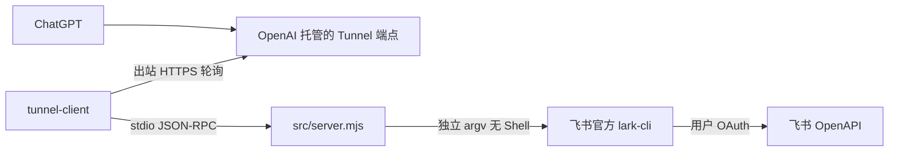
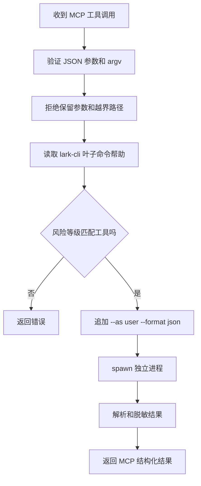

# 实现原理与安全边界

本文面向维护者和希望审核代码的使用者，说明项目为什么采用 `lark-cli` 适配层、一次工具调用如何执行，以及服务端实施了哪些安全限制。安装和日常使用步骤见[完整安装与使用指南](getting-started.md)。

## 1. 组件关系



各组件的职责：

| 组件 | 来源 | 职责 |
| --- | --- | --- |
| ChatGPT 自定义 MCP 连接（OpenAI 归入开发者模式） | OpenAI | 选择工具、组织参数、展示确认和结果 |
| Secure MCP Tunnel | OpenAI | 在不开放入站端口的情况下转发 MCP 请求 |
| `src/server.mjs` | 本项目 | 把 MCP 工具映射到受限的 `lark-cli` 调用，并实施风险控制 |
| `lark-cli` | 飞书官方 | 完成用户 OAuth、权限检查、业务命令和 OpenAPI 请求 |
| 飞书自建应用 | 使用者所有 | 定义可申请的 scope 和应用可用范围 |

Secure MCP Tunnel 是传输通道，不负责飞书身份验证。飞书登录态由本机 `lark-cli` 管理。

## 2. 为什么封装 lark-cli

项目目标是通用操作飞书，而不只是读写文档。飞书官方 `lark-cli` 提供大量业务域命令，并保留原始 OpenAPI 调用入口，因此可以覆盖：

- 文档、知识库、云盘、电子表格、多维表格和幻灯片；
- 消息、群聊、日历、任务和审批；
- 邮箱、通讯录、会议、OKR 等业务；
- CLI 尚未封装成便捷命令的 `/open-apis/` 接口。

直接把整个 CLI 暴露给模型会带来过大的执行面。适配层没有提供任意 Shell，而是只开放六个稳定 MCP 工具，并在服务端重新验证业务域、参数、风险等级和本地文件路径。

## 3. MCP 工具契约

### `feishu_auth_status`

执行 `lark-cli auth status --json --verify`，检查登录和 token 有效性。返回结果会经过敏感字段脱敏。

### `feishu_command_help`

读取业务域或叶子命令的官方帮助。它只接受有限长度、由字母、数字和少量安全符号组成的命令路径。

### `feishu_command_read`

仅允许官方帮助标记为 `Risk: read` 的命令。适配层会先读取叶子命令帮助，再决定是否执行。

### `feishu_command_write`

仅允许 `Risk: write` 的普通写入，并要求调用参数中包含 `confirmed: true`。该字段表示使用者已经明确提出当前具体写入，不代表对后续不同写入的长期授权。

### `feishu_high_risk_preview`

仅处理 `Risk: high-risk-write` 的命令。服务先使用 `--dry-run` 生成预览，不修改飞书数据；预览成功后产生一个十分钟有效的一次性确认令牌。

### `feishu_high_risk_execute`

只能使用仍有效且未使用过的确认令牌执行原命令。令牌绑定预览时的参数，调用方不能在执行阶段替换目标或追加参数。

## 4. 请求执行流程

普通读取或写入的流程：



高风险写入增加一次 preview 和一次性令牌步骤。所有写操作还会进入进程内队列，避免同一服务实例中的写入并发交错。

## 5. 命令边界

### 允许的业务域

`src/server.mjs` 当前允许：

```text
api, approval, attendance, base, calendar, contact, docs, drive,
im, mail, markdown, mindnotes, minutes, note, okr, sheets, slides,
task, vc, whiteboard, wiki
```

`application`、`apps` 和长期运行的 `event consume` 不开放给 ChatGPT。这些属于应用管理、开发管理或常驻订阅能力，不适合一次有界 MCP 调用。

### 服务端保留参数

调用方不能传入以下参数：

```text
--as, --delete-local, --dry-run, --format, --from-clipboard,
--help, --jq, --overwrite, --profile, --yes
```

这些参数由服务控制，避免调用方绕过用户身份、输出解析、dry-run、高风险确认或本地文件保护。`--json` 没有被保留，因为它在部分业务命令中是必需的输入参数；服务仍固定追加 `--format json`。

### 不使用 Shell 拼接

适配层使用 Node.js `spawn`，把每个参数作为独立 argv 元素传递，并设置 `shell: false`。输入不会拼接到 `sh -c`、`zsh -c`、`cmd /c` 或 PowerShell 字符串中。

Windows 上，npm 生成的 `lark-cli.cmd` 可能再次解析多行文本和引号。`scripts\windows\run.ps1` 因此把 `LARK_CLI_PATH` 指向官方包内的 `scripts\run.js`，`src/server.mjs` 再使用当前 Node.js 进程直接调用它。

## 6. 原始 OpenAPI 的处理

原始接口只允许以下形式：

```text
lark-cli api METHOD /open-apis/...
```

限制包括：

- HTTP 方法只允许 `GET`、`HEAD`、`POST`、`PUT`、`PATCH` 和 `DELETE`；
- 路径必须以 `/open-apis/` 开头，不能传任意完整 URL；
- `GET` 和 `HEAD` 按只读处理；
- 其他方法全部按高风险写入处理。

非 GET 请求可能删除数据、撤销权限、转移所有权或触发外部动作。由于原始接口缺少稳定的业务风险元数据，项目不根据 `POST` 等方法猜测其影响，而是一律要求 preview 和二次确认。

## 7. 身份和权限模型

每条业务命令都会追加：

```text
--as user --format json
```

最终权限是四层交集：

```text
ChatGPT 账号或工作区允许的 MCP 能力
        ∩
飞书应用已开通并发布的 scope
        ∩
当前用户 OAuth 授予的 scope
        ∩
当前用户对目标资源原本拥有的权限
```

任意一层拒绝，调用都应失败。适配层不会提升飞书权限，也不会使用 bot 身份绕过个人资源权限。

## 8. 本地文件边界

启动脚本会把 `workspace/` 设为 MCP 工作目录。`--file`、`--attach`、`--body-file`、`--image`、`--local-dir`、`--output*` 等已知本地路径参数，以及任意 `@file` 间接输入，都会在执行前检查。

允许：

- MCP 工作目录内的相对路径；
- 标准输入标记 `-`。

拒绝：

- 绝对路径；
- 包含 `..` 的路径；
- 通过符号链接尝试逃离工作目录的路径；
- `file:` URL；
- 读取系统剪贴板；
- 覆盖或删除已有本地文件的保留参数。

这个边界减少模型读取任意本地文件或把结果写到任意系统位置的风险。

## 9. 输出、超时和脱敏

每次 CLI 调用的主要限制：

- 最长运行时间：120 秒；
- 最大输出：8 MiB；
- 最大参数总量：1 MiB；
- argv 元素数量：1 到 128。

响应返回前会递归遮蔽常见敏感字段，包括 access token、refresh token、App Secret、Authorization 和 password。超时、输出过大或进程启动失败会返回结构化错误。

## 10. 项目文件

```text
src/server.mjs                MCP 适配层实现
scripts/macos/                macOS 初始化和启动脚本
scripts/windows/              Windows 初始化和启动脚本
profiles/                     本地 profile，个人内容不提交
workspace/                    本地文件上传/下载边界，内容不提交
test/adapter.test.mjs         MCP 契约和安全边界测试
test/fixtures/                测试替身
docs/                         安装、架构和排障文档
docs/assets/screenshots/      文档截图；提交前移除个人信息与凭据
```

## 11. 测试范围

`npm test` 使用假的 `lark-cli` 进程验证：

- MCP 初始化和六个工具的 schema；
- 用户登录状态解析；
- 只读、普通写入和高风险写入分流；
- `--yes` 等保留参数无法注入；
- 原始 OpenAPI 写入不能绕过高风险流程；
- 本地路径不能使用绝对路径、`..` 或符号链接逃离工作区；
- 剪贴板读取和本地覆盖参数被拒绝；
- 高风险令牌只能使用一次；
- JS runner 通过 Node.js 和独立 argv 调用。

测试不会访问真实飞书账号。发布前还需要在 macOS 和 Windows 上完成真实登录、Tunnel 连接、读取、普通写入和高风险预览的端到端验证。

## 12. 设计边界

本项目不是：

- 任意本地 Shell 或远程命令执行服务；
- 飞书权限提升工具；
- 公开托管的多租户飞书连接器；
- 可直接提交到公共 Plugins Directory 的远程插件；
- 长时间运行的飞书事件消费者。

OpenAI 官方说明 Secure MCP Tunnel 适用于私有连接和开发者模式测试，但不替代公开插件提交所需的稳定公网 HTTPS MCP endpoint。[Secure MCP Tunnel 的发布边界](https://developers.openai.com/api/docs/guides/secure-mcp-tunnels)
