# 在 ChatGPT 中操作飞书：完整安装与使用指南

完成配置后，可以直接在 ChatGPT 对话中用自然语言读取和操作自己有权限访问的飞书数据，例如文档、云盘文件、日程、消息和任务。操作由 ChatGPT 中已连接的工具发起，不需要在 `Codex` 任务中执行；本项目也不会调用 Codex。是否允许写入、需要何种确认以及产品使用限制，以实际账号和 workspace 的界面与规则为准。

## 工作方式

```text
ChatGPT 对话
        ↓
ChatGPT 中的个人 MCP 连接
        ↓
OpenAI Secure MCP Tunnel（仅出站 HTTPS）
        ↓
本机 MCP 适配层
        ↓
本机官方 lark-cli（飞书用户登录态）
        ↓
飞书 OpenAPI
```

先在本机用官方 `lark-cli` 登录飞书；本项目的 MCP 适配层会把 ChatGPT 的工具请求转换为相应的 `lark-cli` 操作。`tunnel-client` 只从本机向 OpenAI 建立出站 HTTPS 连接，OpenAI 托管 Tunnel 入口并将请求转回本机；本地服务不会直接开放到公网，也不需要公网 IP。最后，在 ChatGPT Plugins 中新建个人 MCP 连接，连接方式选择 **Tunnel**，并选择或填入自己的 `tunnel_id`。

OpenAI 将这类自定义连接归入开发者模式。若“账户安全与登录”中显示该开关，请开启；若开关未显示但已经可以创建和使用 Tunnel 连接，则所需访问权限已生效，无须继续寻找该开关。[OpenAI Secure MCP Tunnel 官方说明](https://developers.openai.com/api/docs/guides/secure-mcp-tunnels) [ChatGPT 连接步骤](https://developers.openai.com/plugins/deploy/connect-chatgpt)

## 1. 准备账号和权限

开始前需要：

- macOS，或 Windows 10/11；
- Node.js 20 或更高版本；
- 能创建或绑定自建飞书应用的账号；
- 能在飞书应用后台开通权限并发布版本的权限；
- 能在 OpenAI Platform Organization 中创建或使用 Tunnel 的权限；
- 目标 ChatGPT 账号具备创建自定义 MCP 连接的权限；如果已能在 Plugins 页面创建并使用 Tunnel 连接，说明此权限已经生效。

OpenAI 的 Tunnel 权限与 ChatGPT 的自定义 MCP 访问权限相互独立：

- 创建或编辑 Tunnel 需要 `Tunnels Read + Manage`；
- 运行 `tunnel-client` 或在 ChatGPT 中选择 Tunnel 需要 `Tunnels Read + Use`；
- ChatGPT 的自定义 MCP 访问还受账号和 workspace 管理策略影响。

企业工作区中缺少权限时，需要分别联系 Platform Organization 管理员和 ChatGPT workspace 管理员。[OpenAI Tunnel 权限说明](https://developers.openai.com/api/docs/guides/secure-mcp-tunnels#permissions-and-access)

## 2. 安装 Node.js 和 lark-cli

在 Terminal 或 PowerShell 中检查 Node.js：

```text
node --version
npm --version
```

未安装时，从 [Node.js 官网](https://nodejs.org/) 安装当前 LTS 版本，然后重新打开终端。

安装飞书官方 `lark-cli`：

```text
npx @larksuite/cli@latest install
lark-cli --version
```

如果第二条命令找不到 `lark-cli`，先重新打开终端；仍然失败时，按照 npm 的提示把全局命令目录加入用户 `PATH`。

## 3. 创建或绑定飞书应用

运行配置向导：

```text
lark-cli config init --new
```

向导可以创建新应用或绑定已有应用。手工管理应用时，入口是[飞书开放平台开发者后台](https://open.feishu.cn/app?lang=zh-CN)。

应用至少需要完成以下事项：

1. 配置 App ID 和 App Secret；
2. 开通实际需要的权限范围；
3. 创建并发布应用版本；
4. 按组织流程完成管理员审批；
5. 确保使用者位于应用可用范围内。

App Secret 不应出现在 Git、聊天记录、截图或可共享脚本中。优先通过 `lark-cli` 配置向导安全输入，而不是把 Secret 写在命令行参数里。

飞书调用最终能否成功，由以下权限的交集决定：

```text
飞书应用后台已开通并发布的权限
        ∩
当前用户通过 OAuth 授予的权限
        ∩
当前用户对具体文档、群、日历等资源的访问权限
```

## 4. 登录飞书

如果这台电脑已经用当前 `lark-cli` 配置完成飞书用户登录，先检查：

```text
lark-cli auth status --json --verify
```

命令成功且显示用户登录有效时，无需再次登录，可直接继续第 5 步。若这是首次配置、更换了飞书应用，或验证失败，则使用飞书官方命令登录。

### 常规登录：全部业务域

请求本项目支持的全部业务域，并按提示在浏览器中完成飞书授权：

```text
lark-cli auth login --domain all
```

授权完成后检查登录状态：

```text
lark-cli auth status --json --verify
```

输出应表明用户登录有效。项目始终以用户身份访问飞书，不使用 bot 身份替代个人权限。

### 按需授权（高级）

上述常规登录命令会请求全部业务域。希望遵循最小权限原则时，才改为按业务域授权。例如：

```text
lark-cli auth login --domain docs
lark-cli auth login --domain drive
lark-cli auth login --domain calendar
```

使用中出现 `missing_scope` 或 `need_user_authorization` 时，根据错误中的 scope 回到飞书应用后台开通权限、发布新版本，再重新授权对应业务域。

## 5. 创建 OpenAI Tunnel 和 Runtime API Key

打开 [OpenAI Platform Tunnels](https://platform.openai.com/settings/organization/tunnels)，在准备使用的 Platform Organization 中进入 **Tunnels**，再点击右上角的 **Create tunnel**：

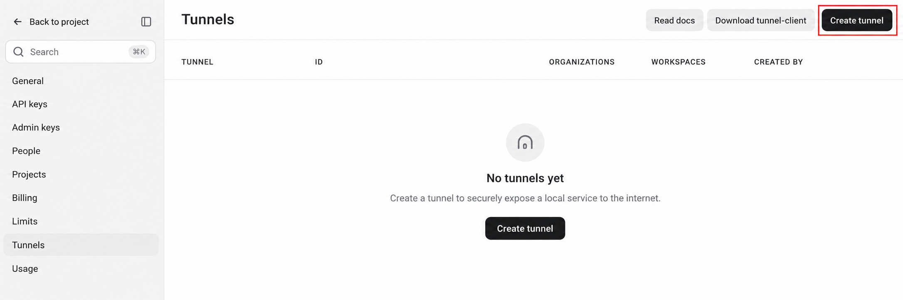

### 填写创建表单

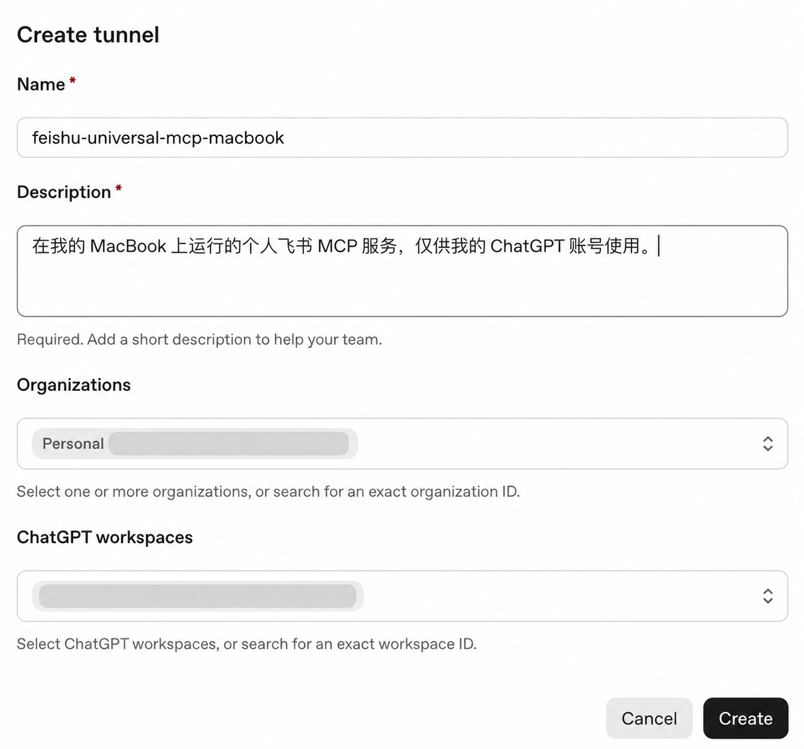

按下表填写，然后点击 **Create**：

| 字段 | 填写方式 |
| --- | --- |
| **Name** | 使用容易识别的名称，例如 `feishu-universal-mcp-macbook`、`feishu-universal-mcp-windows` 或 `feishu-universal-mcp-工作电脑`。名称只用于识别，不影响连接功能。 |
| **Description** | 例如“在我的 MacBook 上运行的个人飞书 MCP 服务，仅供我的 ChatGPT 账号使用。”描述同样只用于识别。 |
| **Organizations** | 选择管理此 Tunnel 的 Platform Organization；个人账号通常选择 `Personal`。 |
| **ChatGPT workspaces** | 选择准备在 ChatGPT 中使用此连接的 workspace。 |

### 保存 Tunnel ID

创建完成后，在 Tunnel 列表中复制 `tunnel_...` 形式的 Tunnel ID；后续初始化 profile 和在 ChatGPT 创建连接时都会用到它：

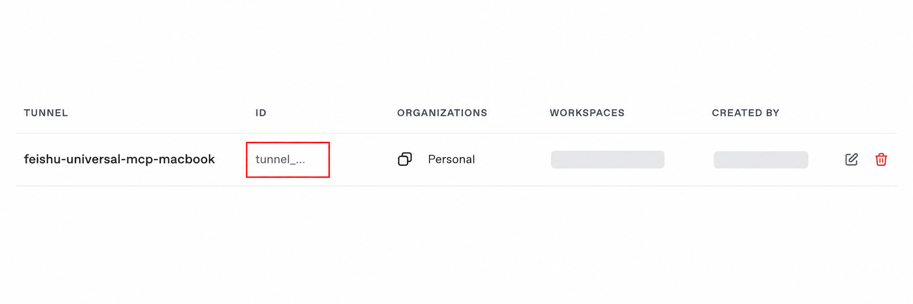

### 创建受限的 Runtime API Key

本指南把供本机 `tunnel-client` 连接 OpenAI Tunnel 使用的受限 secret key 称为“Runtime API Key”。请为它单独创建一把受限 Key，不要复用全权限的模型 API Key。

1. 在 OpenAI Platform 选择项目后，进入 **API keys**，点击 **Create new secret key**：

   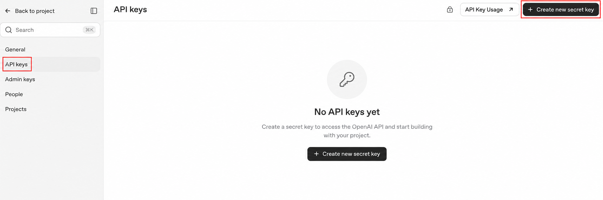

2. 按下列方式填写，然后点击 **Create secret key**：
   - **Owned by**：个人使用选择 **You**；
   - **Name**：例如 `feishu-tunnel-runtime`；
   - **Project**：选择 **Default project**；不需要专门为 Tunnel 新建项目；
   - **有效期**：例如自定义为 90 天；到期前创建新 Key 并更新本机配置；
   - **Permissions**：选择 **Restricted**，不要选择全权限的 **All**。

   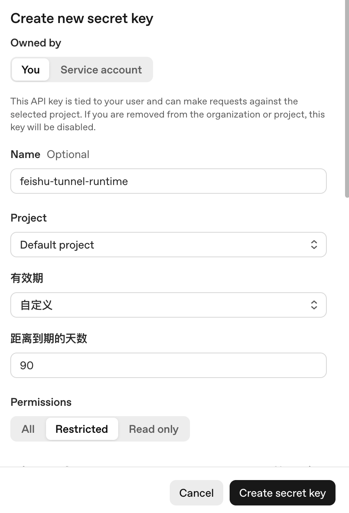

3. 在权限列表中，除 **Tunnels** 外保持 **None**；把 **Tunnels** 设为 **All selected**。这会授予 `tunnel-client` 所需的 Tunnel 读取与使用权限：

   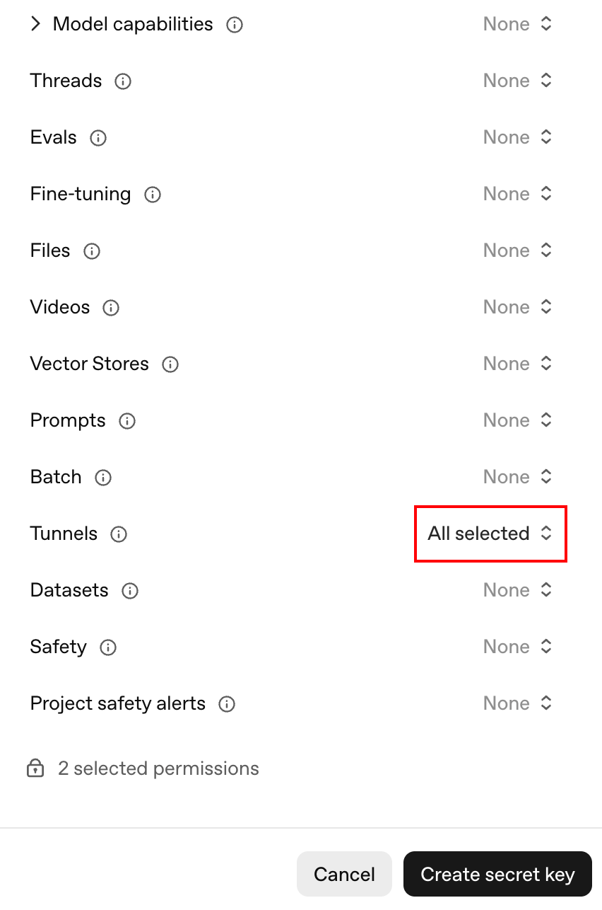

4. Key 只会完整显示一次。点击 **Copy** 后立即存入密码管理器，再点击 **Done**；不要把它写进仓库、profile、截图或聊天记录。

   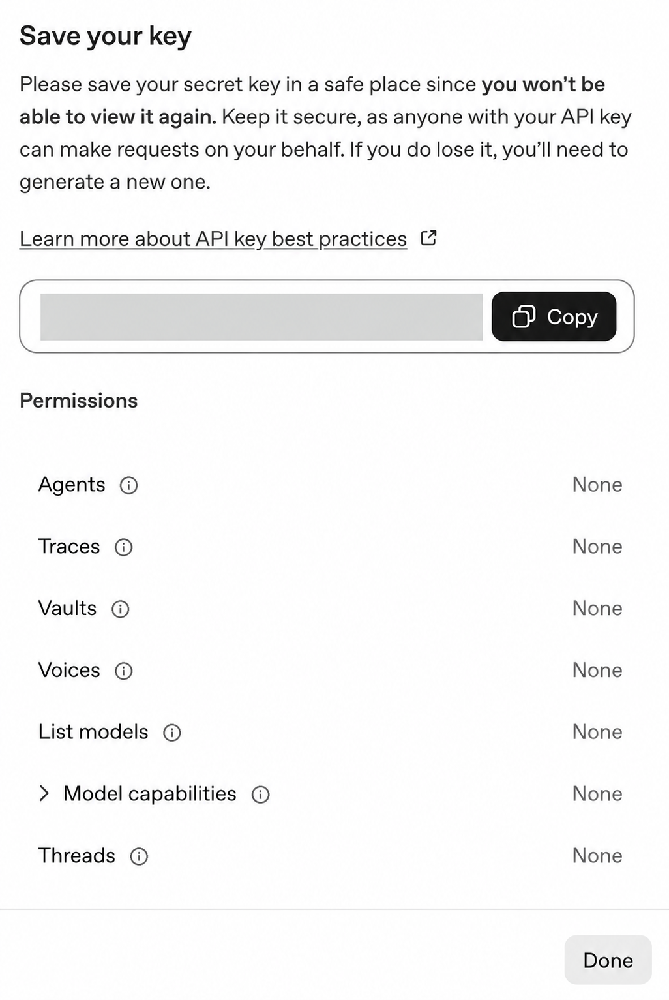

若复制的 Key 不完整或误用了不适用于 Tunnel 的 Key，可能出现：

```text
configure tunnel-client: control plane API key is malformed
```

到这里，Tunnel ID 和 Runtime API Key 都已准备好。Tunnel 若只关联 Platform Organization、没有关联目标 ChatGPT workspace，可能不会出现在 ChatGPT 的连接页面。

## 6. 安装 tunnel-client

从 Tunnel 设置页的下载入口，或 [openai/tunnel-client 最新版本](https://github.com/openai/tunnel-client/releases/latest)下载。本文最后核对时，当前版本是 `v0.0.15`；请下载下表中的 **ZIP** 文件。不要下载名称含有 `source`、`licenses`、`spdx`、`runtime`、`cloudflared` 或 `all` 的文件。

| 电脑类型 | 应下载的完整文件名 |
| --- | --- |
| macOS，Apple 芯片（M1、M2、M3、M4 等） | `tunnel-client-v0.0.15-darwin-arm64.zip` |
| macOS，Intel 芯片 | `tunnel-client-v0.0.15-darwin-amd64.zip` |
| Windows，Intel 或 AMD 电脑（绝大多数） | `tunnel-client-v0.0.15-windows-amd64.zip` |
| Windows，ARM 电脑 | `tunnel-client-v0.0.15-windows-arm64.zip` |

将来如果 GitHub 上出现更高版本，文件名中的 `v0.0.15` 会变化；选择相同系统和架构后缀的 `tunnel-client-v<版本号>-...zip` 文件即可。

### macOS

查看架构：

```zsh
uname -m
```

- `arm64` 下载 `tunnel-client-v0.0.15-darwin-arm64.zip`；
- `x86_64` 下载 `tunnel-client-v0.0.15-darwin-amd64.zip`。

双击 ZIP 文件解压。macOS 的“归档实用工具”会创建与 ZIP 同名的文件夹，例如 `tunnel-client-v0.0.15-darwin-arm64`；实际要安装的文件是该文件夹内的 `tunnel-client`。同时出现的 `cloudflared`、许可证和清单文件不需要单独安装。假设 ZIP 位于“下载”目录，Apple 芯片 Mac 解压后安装：

```zsh
chmod +x "$HOME/Downloads/tunnel-client-v0.0.15-darwin-arm64/tunnel-client"
sudo install -m 0755 "$HOME/Downloads/tunnel-client-v0.0.15-darwin-arm64/tunnel-client" /usr/local/bin/tunnel-client
tunnel-client --version
```

Intel Mac 请把命令中的 `tunnel-client-v0.0.15-darwin-arm64` 改为 `tunnel-client-v0.0.15-darwin-amd64`。

如果 macOS 阻止运行，先核对下载的文件确实来自 OpenAI 官方 release。若在“系统设置 → 隐私与安全性”选择允许后，仍提示“Apple 无法验证 `tunnel-client`”，说明下载隔离标记仍在已安装文件上。运行：

```zsh
sudo xattr -d com.apple.quarantine /usr/local/bin/tunnel-client
tunnel-client --version
```

第一条命令会要求输入 macOS 管理员密码，输入时终端不会显示字符。它只移除该文件的下载隔离标记，不会修改二进制内容。

### Windows

在 PowerShell 查看架构：

```powershell
[System.Runtime.InteropServices.RuntimeInformation]::OSArchitecture
```

- `X64` 下载 `tunnel-client-v0.0.15-windows-amd64.zip`；
- `Arm64` 下载 `tunnel-client-v0.0.15-windows-arm64.zip`。

解压后把 `tunnel-client.exe` 放到固定目录，例如：

```text
C:\Tools\tunnel-client\tunnel-client.exe
```

在“编辑账户的环境变量”中把以下目录加入用户 `Path`：

```text
C:\Tools\tunnel-client
```

重新打开 PowerShell 后验证：

```powershell
Get-Command tunnel-client.exe
tunnel-client.exe --version
```

确认文件来自 OpenAI 官方 release 后，可以解除下载标记：

```powershell
Unblock-File -LiteralPath "C:\Tools\tunnel-client\tunnel-client.exe"
```

## 7. 克隆仓库

```text
git clone https://github.com/wuhuawei1996/feishu-universal-mcp.git
cd feishu-universal-mcp
```

后续生成 profile 和启动服务的脚本都位于这个目录中；请保持终端当前目录为仓库根目录。

## 8. 生成本地 profile

profile 会包含个人 Tunnel ID 和本机绝对路径，因此已被 `.gitignore` 排除。Runtime API Key 和可选 Tunnel 代理由启动脚本分别保存，不会写入 profile。

macOS：

```zsh
chmod +x scripts/macos/*.zsh
./scripts/macos/init-profile.zsh
```

Windows PowerShell：

```powershell
Unblock-File -LiteralPath ".\scripts\windows\init-profile.ps1"
Unblock-File -LiteralPath ".\scripts\windows\run.ps1"
.\scripts\windows\init-profile.ps1
```

脚本会提示输入 Tunnel ID（即上一节从 Tunnel 列表复制的完整 `tunnel_...` 字符串），并生成：

```text
profiles/feishu-universal.yaml
```

生成的 profile 会包含：

- `control_plane.base_url: https://api.openai.com`；
- 使用者自己的 `tunnel_id`；
- `api_key: env:CONTROL_PLANE_API_KEY`；
- 指向本机 Node.js 和项目 MCP 服务的命令；
- 仅监听 `127.0.0.1` 的健康检查地址。

不要把 Runtime API Key 直接写进 YAML。

## 9. 启动服务

macOS：

```zsh
./scripts/macos/run.zsh
```

Windows PowerShell：

```powershell
.\scripts\windows\run.ps1
```

首次启动时，脚本会隐藏读取 Runtime API Key 并保存；后续启动会自动读取。除此之外，启动脚本会：

1. 检查项目 profile 是否存在；
2. 自动读取已保存的 Tunnel 代理（如已配置）；
3. 验证飞书用户登录状态；
4. 设置适配层使用的 `LARK_CLI_PATH`；
5. 创建 `workspace/` 并将其设为 MCP 工作目录；
6. 启动 `tunnel-client`。

Runtime API Key 不写进 YAML：macOS 保存到当前用户的“钥匙串访问”，位于仓库之外；Windows 保存为 `profiles/runtime-api-key.dpapi`，仅当前 Windows 用户能解密，且该文件已被 Git 忽略。首次输入后，后续直接运行启动脚本即可，无需再次粘贴 Key。

需要更换或撤销本机保存的 Key 时，先执行以下命令，再正常启动脚本并输入新 Key：

macOS：

```zsh
./scripts/macos/run.zsh --forget-runtime-key
```

Windows PowerShell：

```powershell
.\scripts\windows\run.ps1 -ForgetRuntimeKey
```

需要上传本地文件时，先把文件放入 `workspace/`，再让 ChatGPT 使用相对路径，例如 `report.xlsx`。下载的文件也只会写入该目录。`workspace/` 中的个人内容已被 `.gitignore` 排除。

看到 `tunnel-client started` 表示本机进程已经启动。继续观察终端，确认没有持续出现认证或网络错误后再创建 ChatGPT 连接；`ready` 或健康状态可进一步确认本地客户端可用：

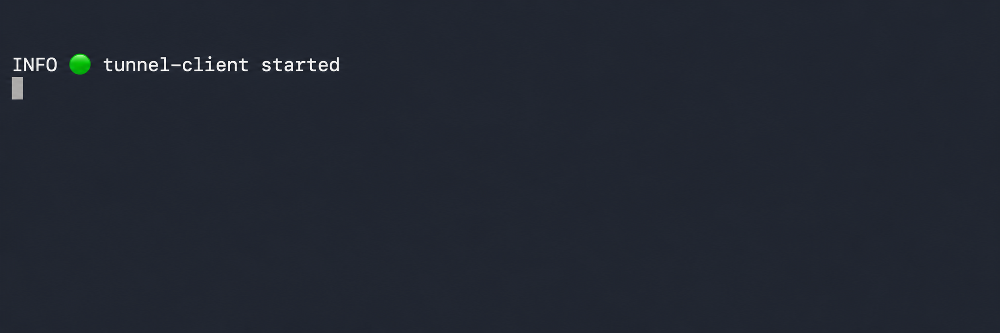

此时**让终端保持运行**。关闭窗口或按 `Ctrl+C` 后，ChatGPT 将无法继续调用本地工具。

### 添加插件失败或工具无法调用时配置代理

绝大多数网络不需要配置代理。某些网络中，`tunnel-client` 仍可能先显示 `started` 或 `ready`，但直到在 ChatGPT 添加连接、发现工具或调用工具时才报错。这通常是本机无法稳定访问 `api.openai.com:443`；此时再为 Tunnel 配置代理。

如果使用 Clash Verge，常见的 HTTP / Mixed Port 是 `7897`。若你在 Clash Verge 或其他代理软件中修改过端口，请使用软件里显示的实际 **HTTP 代理端口**。

下面的命令只需执行一次：脚本会保存代理，之后正常运行 `run` 脚本时自动使用，无需每次重新配置。保存后，再执行本节开头的正常启动命令。

macOS：

```zsh
./scripts/macos/run.zsh --set-proxy "http://127.0.0.1:7897"
```

Windows PowerShell：

```powershell
.\scripts\windows\run.ps1 -SetProxy "http://127.0.0.1:7897"
```

脚本只把它作为 `tunnel-client` 的控制平面代理，只代理本机到 OpenAI Tunnel 的出站连接；飞书登录和本地 MCP 不会改走该设置。macOS 保存在当前用户的钥匙串；Windows 保存在仅当前用户可解密的 `profiles/tunnel-http-proxy.dpapi` 文件中，且该文件已被 Git 忽略。

不再需要代理时，执行一次清除命令：

```zsh
./scripts/macos/run.zsh --forget-proxy
```

```powershell
.\scripts\windows\run.ps1 -ForgetProxy
```

若只想临时换用另一个代理，可以在一次启动前设置 `TUNNEL_HTTP_PROXY`；它会覆盖保存的代理，但关闭终端后失效：

```zsh
TUNNEL_HTTP_PROXY="http://127.0.0.1:7898" ./scripts/macos/run.zsh
```

```powershell
$env:TUNNEL_HTTP_PROXY = "http://127.0.0.1:7898"
.\scripts\windows\run.ps1
```

不要把代理账号、密码或个人地址写进 profile 或提交到仓库。

## 10. 在 ChatGPT 中创建连接

创建前，请保持第 9 节启动的 Tunnel 终端正在运行，且终端中没有持续出现认证或网络错误。OpenAI 将自定义 MCP 连接归入“开发者模式”：如果“账户安全与登录”中显示该开关，请开启；若未显示但已能创建 Tunnel 连接，可直接继续。

### 打开创建入口

打开 [ChatGPT Plugins](https://chatgpt.com/plugins)，点击右上角 **添加**，再选择 **创建 MCP 应用**。

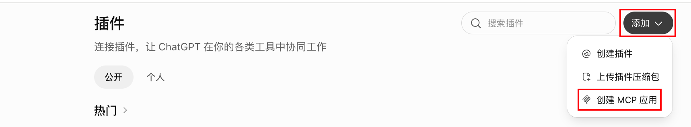

### 填写 MCP 应用

在表单中按下表填写：

| 字段 | 填写内容 |
| --- | --- |
| 名称 | 例如“飞书助手” |
| 描述 | 可填写“通过本机飞书登录读取和操作我有权限访问的飞书数据” |
| 连接 | 选择 **隧道** |
| Tunnel | 选择可见的 Tunnel，或粘贴本教程创建的完整 `tunnel_...` ID |
| 身份验证 | 选择 **无需身份验证** |

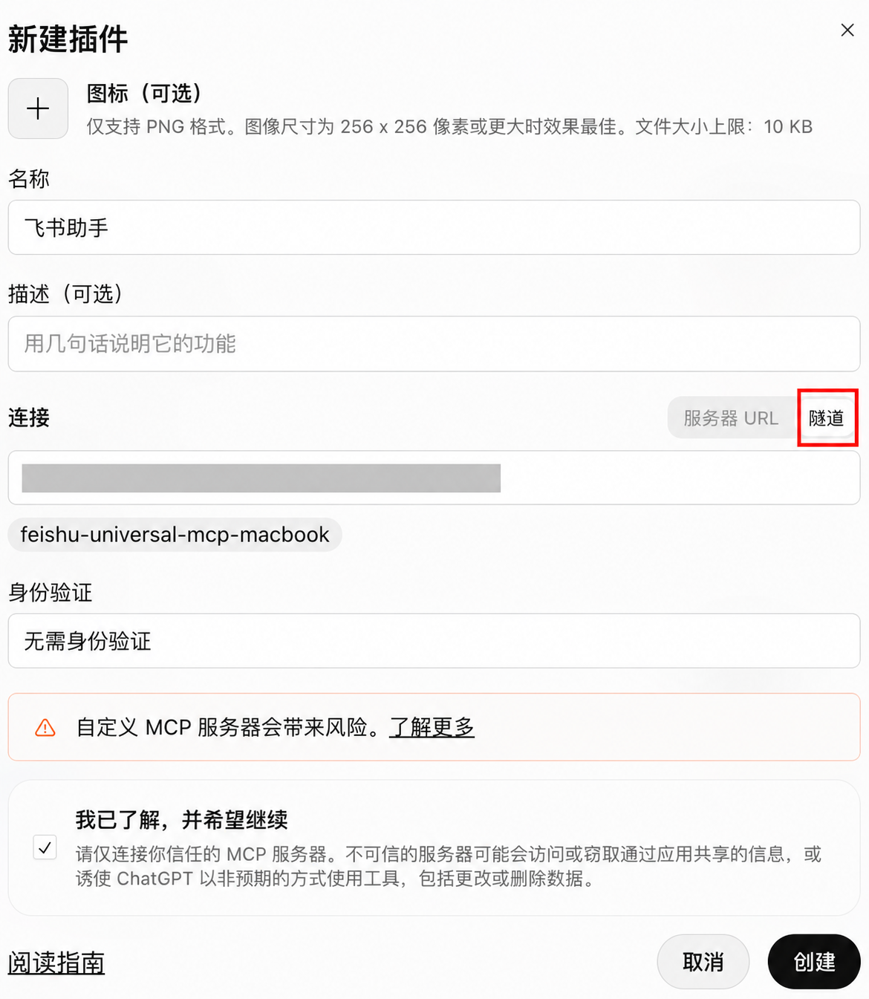

这里选择“无需身份验证”，因为 ChatGPT 不需要再对本地 MCP 发起第二套飞书 OAuth。访问飞书使用的是本机 `lark-cli` 已保存的用户授权；Tunnel 本身仍由 Runtime API Key 和组织权限保护。

### 创建并确认

勾选风险提示中的“我已了解，并希望继续”，点击 **创建**。随后新建 ChatGPT 对话，点击输入框左侧加号，在菜单中选择刚创建的“飞书助手”（名称取决于表单中的名称）。

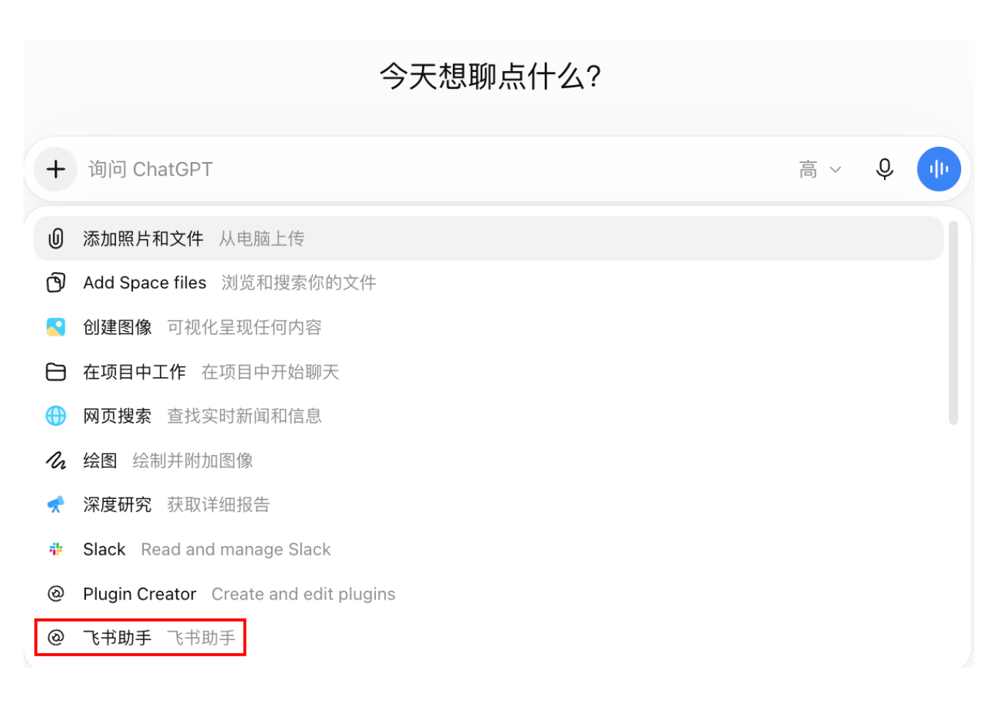

发送“飞书助手，你有几个工具？请同时检查登录状态。”进行检查。返回六个工具且登录状态可用，即表示连接已经成功：

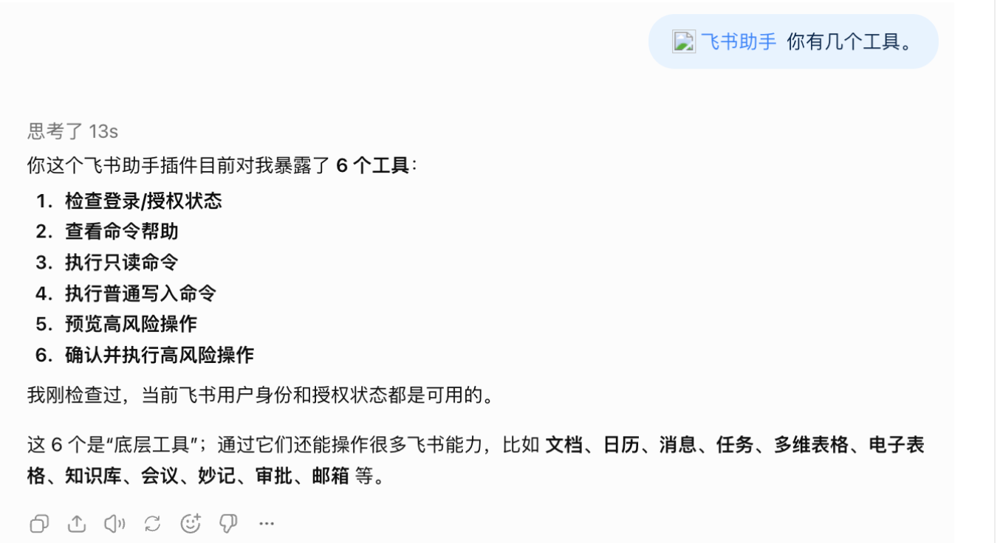

本项目暴露的六个底层工具为：

```text
feishu_auth_status
feishu_command_help
feishu_command_read
feishu_command_write
feishu_high_risk_preview
feishu_high_risk_execute
```

界面入口和自定义 MCP 访问权限可能受账号和 workspace 策略影响。[OpenAI 连接与测试说明](https://developers.openai.com/plugins/deploy/connect-chatgpt)

## 11. 分级验证

建议在新对话中按以下顺序测试。

### 登录状态

```text
请检查我的飞书登录状态，只读取，不要修改任何内容。
```

### 命令帮助

```text
请查看飞书 docs 业务域有哪些命令，只查看帮助。
```

### 读取

```text
请读取这个飞书文档并总结，不要修改：
https://企业域名.feishu.cn/docx/文档Token
```

### 普通写入

准备一个临时测试文档：

```text
请在这个测试文档末尾追加一行“ChatGPT MCP 写入测试”，除此之外不要修改任何内容：
https://企业域名.feishu.cn/docx/文档Token
```

### 高风险操作

只使用临时测试资源，并在提示中给出测试资源的链接或 ID：

```text
请先预览删除以下测试资源会发出的请求，不要执行。把目标和影响展示给我，等我明确同意后再继续：
<测试资源链接或 ID>
```

适配层应先返回一次性确认令牌。只有使用者看过预览并明确同意后，才执行真实操作。

## 12. 日常使用

### 每次使用

每次使用前：

1. 运行当前平台的 `run` 脚本；
2. 仅首次启动或更换 Key 后输入 Runtime API Key；
3. 保持 Tunnel 终端运行；
4. 新建 ChatGPT 对话，点击输入框左侧的加号，在菜单中选择“飞书助手”（名称取决于创建连接时填写的名称）；
5. 明确说明读取或修改的对象、范围和预期结果。

每个新对话都要选择一次已有的“飞书助手”。这是为该对话启用已有连接，不是重新创建 MCP 应用。

如果添加连接或调用工具时提示无法连接，按第 9 节保存代理后重新启动；仅看到启动日志并不代表网络连接在后续请求中一定可用。

飞书用户 token 通常由 `lark-cli` 自动刷新。只有验证失败、权限被撤销或 refresh token 失效时，才需要重新运行 `lark-cli auth login --domain all`。

### 本地服务重启后

不需要重新创建 MCP 应用。ChatGPT Plugins 中已有的“飞书助手”会一直保留；只有删除该应用或更换 Tunnel ID 时才需要重新创建。

本项目的本地 MCP 由 `tunnel-client` 以子进程方式启动，因此不要单独运行或重启 `src/server.mjs`。需要重启时，在原终端按 `Ctrl+C`，再运行当前平台的完整启动脚本：

```zsh
./scripts/macos/run.zsh
```

```powershell
.\scripts\windows\run.ps1
```

停止本地服务会终止正在使用它的 ChatGPT 对话会话，原对话可能显示 `Session terminated`。重新启动后，新建一个 ChatGPT 对话，在加号菜单中选择已有的“飞书助手”再重试。

## 13. 下一步

- 出现错误：查看[故障排查](troubleshooting.md)；
- 了解为何只暴露六个工具：查看[实现原理与安全边界](architecture.md)；
- 准备公开仓库：查看[安全说明](../SECURITY.md)和[贡献指南](../CONTRIBUTING.md)。
